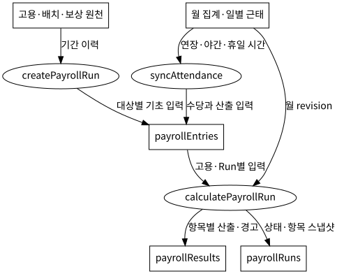

# 시스템 아키텍처 및 모듈 책임

문서 1.0 · 분석 커밋 b4aeb300270a62273d3d5f0c2fea87f2a09ba800 · 관련 요구사항 R-01~17

| 구성요소 | 목적·동작 | 연결·한계 | 코드 |
|---|---|---|---|
| Interface / Type | 직원·급여 객체가 어떤 필드와 값을 가져야 하는지 컴파일 시 검사하는 계약이다. | Employment.personId는 사람과 고용을 연결한다. 문자열 타입만으로 실제 Person의 존재를 보장할 수 없다. | src/domain/types.ts:118 |
| Object | 실행 중 값이 담긴 한 건이다. registerEmployee는 입력에서 이름을 정리하고 새 ID를 만들어 person 객체를 구성한다. | 입력 폼과 저장 객체는 다르다. 조직으로부터 회사 ID를 읽어 Employment에 기록하며 Person은 별도로 저장한다. | src/infrastructure/db/indexedDb.ts:241 |
| Validation | 오류가 파급되기 전에 입력과 현재 업무 상태를 대조하는 판단이다. | 발령 사유는 서비스에서, 회사와 조직의 실제 연결은 저장 경로에서 검사한다. 검사 시점이 너무 이르면 다른 탭의 변경을 놓칠 수 있다. | src/infrastructure/db/indexedDb.ts:582 |
| Service | 화면이 실행할 업무 동작을 제공하는 클래스다. PayrollService.validate는 runId를 받아 저장소의 validatePayrollRun으로 위임한다. | 서비스마다 책임이 다르다. HrService.saveDependent는 필수 성명과 적용기간도 검사한다. | src/modules/payroll/payrollService.ts / src/modules/core-hr/hrService.ts |
| Repository | 저장 방식과 업무 객체 사이에서 읽기·쓰기를 수행한다. IndexedDbHrRepository는 두 저장소 계약을 구현한다. | 급여 산출과 상태 판단까지 이 클래스에 집중된다. 변경 검토 시 화면 외에도 같은 메서드를 호출하는 경로를 찾아야 한다. | src/infrastructure/db/indexedDb.ts |
| IndexedDB / PK / FK | 브라우저가 출처별로 관리하는 객체 저장소다. PK는 한 건을 찾는 키이며 논리적 FK는 다른 저장소의 키를 담는 필드다. | 고용ID·월 복합 유일 인덱스는 월 집계 중복을 거부한다. 고용 삭제의 연쇄 처리나 참조 존재 확인은 앱 책임이다. | src/infrastructure/db/config.ts |
| 트랜잭션 | 여러 쓰기를 한 번에 확정하거나 실패 시 취소하는 단위다. | 직원등록 중 조직이 잘못되면 Person만 남기는 대신 전체 작업을 취소한다. 서로 다른 두 트랜잭션 사이에는 이 보장이 없다. | src/infrastructure/db/indexedDb.ts:241 |
| 스냅샷 | 특정 시점에 선택한 기준을 값으로 보관한다. Run.itemSnapshot에는 계산 항목과 수식이 남는다. | 재계산은 저장 항목을 재사용할 수 있지만 휴직 등도 다시 읽는다. 결과를 재현하려면 항목 외에 원천 버전까지 비교해야 한다. | src/infrastructure/db/indexedDb.ts:780 |
| 마이그레이션 | 저장 버전이 바뀔 때 이미 존재하는 값을 새 구조로 읽을 수 있게 변환한다. | v1 백업에서 변환 불가능한 사람을 만나면 거부한다. 열려 있는 이전 DB 연결은 업그레이드를 막을 수 있어 연결 종료 후 재시도한다. | src/infrastructure/db/indexedDb.ts:1285 |

Core HR과 ATS는 같은 고용 원천을 생성하지만 입력과 승인 조건이 다르다. WFM 월 원천은 Payroll이 소비한다. 평가·보상 디렉터리는 README의 확장 자리이며 채용 평가와 연봉 스냅샷은 별도 기능이다. 운영 일정 검토 화면은 PlanningReviewPanel.tsx에 있다.
## 인접 업무와 실제 구현 범위

| 영역 | 현재 확인한 표면 | 근거 파일 | 검증 깊이 |
|---|---|---|---|
| 채용 | 요청·선발·평가·오퍼 및 입사전환 | src/modules/recruiting/ApplicantIntake.tsx, src/modules/recruiting/AutomationPanel.tsx, src/modules/recruiting/EvaluationPanel.tsx, src/modules/recruiting/KeywordReview.tsx | Payroll 연계는 02·07 참조. 인접 화면은 정적 범위 확인 |
| Core HR | 직원등록·상세·원천 편집·이름 검토 | src/modules/core-hr/EmployeeDetail.tsx, src/modules/core-hr/EmployeeRegistration.tsx, src/modules/core-hr/MasterEditor.tsx | Payroll 연계는 02·07 참조. 인접 화면은 정적 범위 확인 |
| WFM | 일별 입력·월별 합계·업로드 및 마감 | src/modules/attendance/AnnualLeavePanel.tsx, src/modules/attendance/AnnualPromotion.tsx, src/modules/attendance/AttendancePage.tsx, src/modules/attendance/AttendanceTools.tsx | Payroll 연계는 02·07 참조. 인접 화면은 정적 범위 확인 |
| Payroll | 급여 Run, 일용, 원천세, 보험 신고자료, 정산·연말 서류 | src/modules/payroll/CompanyInfoPage.tsx, src/modules/payroll/DailyWorkerPage.tsx, src/modules/payroll/EdiInsuranceWorksheet.tsx, src/modules/payroll/FilingPanel.tsx | Payroll 연계는 02·07 참조. 인접 화면은 정적 범위 확인 |
| Operations | 업무 달력·일정 제안 및 검토·규정·직종 코드 | src/modules/operations/CalendarPanel.tsx, src/modules/operations/ManualScheduleDialog.tsx, src/modules/operations/OccupationPanel.tsx, src/modules/operations/OperationsPanels.tsx | Payroll 연계는 02·07 참조. 인접 화면은 정적 범위 확인 |
| 대시보드 | 월 업무 상태와 추이, 진행상황 및 백업 진입점 | src/app/App.tsx, src/app/DashboardCharts.tsx, src/app/DataToolbar.tsx, src/app/EmployeeIssueBoard.tsx | Payroll 연계는 02·07 참조. 인접 화면은 정적 범위 확인 |
| 성과·보상 | 별도 모듈 확장 위치. 직원 보상 원천 및 ATS 평가는 각 기존 업무에서 확인 | src/modules/performance/README.md | Payroll 연계는 02·07 참조. 인접 화면은 정적 범위 확인 |
| AI·시뮬레이션 | 확장 위치와 계획 문서 | src/simulation/README.md | Payroll 연계는 02·07 참조. 인접 화면은 정적 범위 확인 |

## 급여 데이터 흐름도

사각형은 저장 데이터, 타원은 변환 함수, 화살표 위의 이름은 전달하는 값이다. syncAttendance가 바꾸는 수당 입력과 calculatePayrollRun이 기록하는 revision은 다른 경로다. I-08의 인수 시험은 이 두 경로의 결과를 비교한다. 조직별 수기 승인과 반려 절차는 현재 급여에서 확인되지 않아 별도의 BPMN 승인선을 추가하지 않았다.
